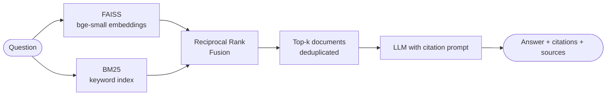

# RAG Document QA with Hybrid Search and LLM Evaluation

A retrieval-augmented question answering service that searches a document collection with **hybrid retrieval** (FAISS vector search + BM25 keyword search, fused with Reciprocal Rank Fusion) and answers with **source citations** using LangChain and OpenAI.

Answer quality is measured automatically: **RAGAS** faithfulness and answer relevancy run on a 300-question test set in **GitHub Actions** on every push and pull request, and the build fails if quality drops below the committed baseline. Retrieval quality (BM25 vs vector-only vs hybrid) is measured against human relevance labels on every change as well.

The default corpus is [BEIR SciFact](https://github.com/beir-cellar/beir): **5,183 scientific abstracts** with **300 test claims** labelled by experts with the abstracts that support or refute them. You can also index your own PDFs, Markdown and text files.

## Architecture



**Why hybrid?** Dense embeddings match meaning ("heart attack" ≈ "myocardial infarction") but blur exact terms. Scientific text is full of terms where exact matching matters: gene names (BRCA1), cytokines (IL-6), drug names, numbers. BM25 catches those. RRF merges the two rankings using ranks only, so cosine distances and BM25 scores never need to be calibrated against each other:

```
score(doc) = Σ  weight_i / (60 + rank_i(doc))
```

**Grounded answers.** The prompt requires a `[doc_id]` citation on every factual sentence, forbids outside knowledge, and gives a fixed refusal sentence when the sources don't contain the answer. Citations are parsed and checked against the retrieved documents, and abstentions are tracked separately so a refusal is never counted as a hallucination.

## Quick start

```bash
cp .env.example .env               # add OPENAI_API_KEY
make install                       # CPU PyTorch + dependencies
make ingest                        # download SciFact and build the index (a few minutes on CPU)
make api                           # http://localhost:8000/docs
```

```bash
curl -s localhost:8000/ask -H 'Content-Type: application/json' \
  -d '{"question": "Does vitamin D supplementation reduce fracture risk?"}'
```

The response includes the `answer`, the `citations` it used, whether it `abstained`, the retrieved `sources` with fusion scores, and retrieval / generation timings. `POST /search` returns ranked documents only, and both endpoints accept `"mode": "hybrid" | "vector" | "bm25"` for side-by-side comparison.

**Your own documents:**

```bash
python -m ragqa.ingest dir ./my_docs --index-dir data/my_index
INDEX_DIR=data/my_index make api
```

PDFs are split per page (citations point to `file.pdf#p3`), and Markdown and text files are chunked with LangChain's recursive splitter.

**Docker:**

```bash
docker compose --profile ingest run --rm ingest   # build the index into ./data
docker compose up api
```

## Evaluation

### Retrieval (no LLM, runs on every push)

`eval/retrieval_eval.py` runs all 300 SciFact test queries through BM25, vector-only and hybrid retrieval, and scores them against the expert relevance labels:

- Precision@k, Recall@k, MRR@k, nDCG@k and hit rate at k = 1, 3, 5, 10
- Latency per query
- Relative change of hybrid vs vector-only

```bash
make eval-retrieval
```

### Answer quality with RAGAS (runs on every push when the API key secret is set)

`eval/ragas_eval.py` turns each test claim into a question, runs the full pipeline, and scores every answer with RAGAS 0.4:

| Metric | How it's measured |
|---|---|
| **Faithfulness** | RAGAS splits the answer into atomic statements and checks each against the retrieved context (LLM-as-judge with NLI) |
| **Hallucination rate** | Share of answered questions with faithfulness below 0.5 |
| **Answer relevancy** | RAGAS generates questions from the answer and compares them to the original with embeddings |
| **Abstention rate** | Share of answers that said the sources were insufficient |
| **Gold citation rate** | Share of answers citing at least one document the experts marked relevant (no LLM needed) |

```bash
make eval-ragas            # hybrid retrieval
make eval-ragas-vector     # same questions with vector-only retrieval
python -m eval.ragas_eval --limit 50     # quick check
```

Every run writes per-question records (answer, citations, contexts, scores) and a summary to `results/`.

### Quality gates in CI

`.github/workflows/ci.yml` runs three jobs:

1. **Lint and unit tests**: 27 tests with fake embeddings and a fake LLM, covering RRF fusion, the IR metrics, chunking, index save/load, citation parsing, abstention, the API, dataset download with mirror fallback, and the RAGAS gate logic.
2. **Retrieval eval**: downloads SciFact, builds the index (cached between runs), evaluates the three retrieval modes, and fails if nDCG@10, Precision@5, Recall@10 or MRR@10 drop by more than 0.01 against `eval/baselines/retrieval.json`.
3. **RAGAS eval**: generates and scores answers for all 300 questions and fails if faithfulness drops by more than 0.03, the hallucination rate rises by more than 3 points, answer relevancy or gold citation rate fall, or faithfulness goes below 0.70.

Results appear in each run's job summary and as downloadable artifacts. A change that hurts retrieval or makes answers less grounded (a prompt edit, a new chunk size, different fusion weights) fails the build before it is merged.

**Setup:**

1. Add `OPENAI_API_KEY` under *Settings → Secrets and variables → Actions*. Without it, the RAGAS job is skipped with a notice.
2. Create the baselines once and commit them:
   ```bash
   make baseline
   git add eval/baselines/*.json && git commit -m "Add evaluation baselines"
   ```
   Until a baseline exists, the jobs report metrics without failing. Rerun `make baseline` when a change is meant to move the numbers.

## Project structure

```
ragqa/
  config.py            Settings (env / .env)
  data/beir.py         BEIR dataset download (with mirror fallback) and loading
  ingest.py            CLI: index SciFact or a directory of PDF / Markdown / text files
  index.py             Chunking + FAISS index and chunk store on disk
  retrieval.py         BM25, vector and hybrid (RRF) LangChain retriever
  pipeline.py          Citation-enforcing RAG chain (LCEL)
  embeddings.py        HuggingFace / OpenAI / fake embedding factory
  api.py               FastAPI: /ask, /search, /stats, /health
eval/
  metrics.py           Precision, recall, MRR, nDCG, hit rate
  retrieval_eval.py    BM25 vs vector vs hybrid report + gate
  ragas_eval.py        RAGAS faithfulness / relevancy + derived metrics + gate
  gates.py             Baseline comparison and GitHub job summaries
  baselines/           Committed baseline metrics used by CI
tests/                 Unit tests and a small BEIR-format fixture
```

## Configuration

| Variable | Default | |
|---|---|---|
| `OPENAI_API_KEY` | | Generation and RAGAS judge |
| `LLM_MODEL` | `gpt-4.1-mini` | Answer generator |
| `EMBEDDING_PROVIDER` | `huggingface` | `huggingface` (local) or `openai` |
| `EMBEDDING_MODEL` | `BAAI/bge-small-en-v1.5` | |
| `RETRIEVAL_MODE` | `hybrid` | `hybrid`, `vector` or `bm25` |
| `TOP_K` | `5` | Documents passed to the LLM |
| `CANDIDATE_K` | `30` | Candidates per retriever before fusion |
| `RRF_K`, `VECTOR_WEIGHT`, `BM25_WEIGHT` | `60`, `1.0`, `1.0` | Fusion parameters |
| `CHUNK_SIZE`, `CHUNK_OVERLAP` | `2000`, `200` | Characters |

## Data

SciFact: Wadden et al., *Fact or Fiction: Verifying Scientific Claims* (EMNLP 2020), distributed through the BEIR benchmark (Thakur et al., 2021).

## License

MIT
